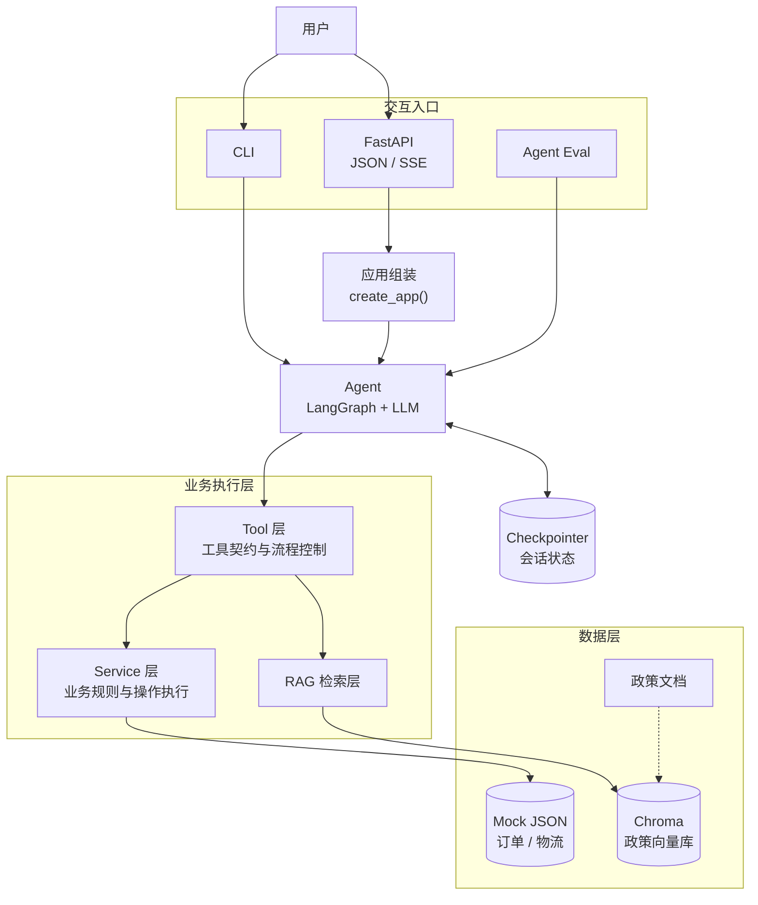
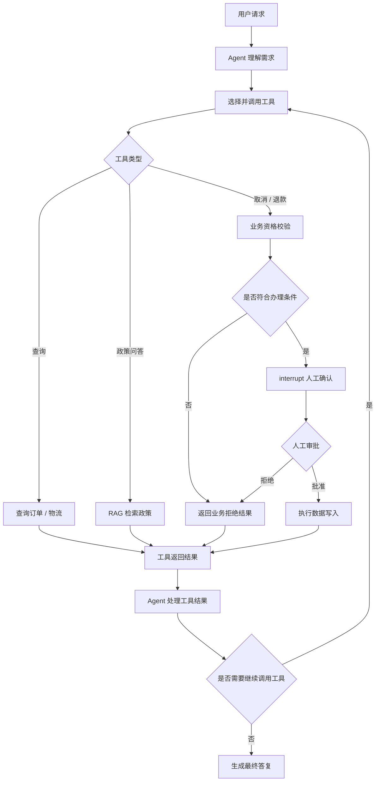

# Customer Service Agent

基于 **LangChain / LangGraph** 构建的智能客服 Agent，面向电商售后场景，支持订单查询、物流查询、政策问答、订单取消和退款受理。

项目采用 Agent + Tools 的执行模式，由 LLM 理解用户意图并选择工具，通过独立的业务服务层执行规则校验与操作。对于取消订单、退款等涉及数据修改的操作，引入 **Human-in-the-Loop（HITL）人工确认机制**，确保只有通过业务校验并获得人工批准的操作才能执行写入。

项目重点关注 Agent 在真实业务场景中的工程化落地，包括业务规则隔离、工具执行安全、会话管理、知识检索、流程控制和自动化评测。

---

## 核心功能

### 1. Agent 与 Tool Calling

基于 LangGraph `create_agent` 构建 Agent，由 LLM 根据用户需求决定工具调用及后续执行步骤。

| 工具 | 功能 | 操作类型 |
|---|---|---|
| `query_order` | 查询订单状态、金额、商品等信息 | 只读 |
| `query_logistics` | 查询发货状态及物流信息 | 只读 |
| `search_knowledge` | 检索退款、配送、售后等业务政策 | 只读 |
| `cancel_order` | 校验取消资格并申请取消订单 | 写操作 |
| `refund_order` | 校验退款资格并申请退款 | 写操作 |

核心设计：

- **业务规则与 Agent 决策分离**：LLM 负责理解需求和选择工具，业务服务层负责资格判断及实际执行。
- **工具职责明确**：Tool 层负责工具契约、执行流程及人工确认，Service 层负责业务规则。
- **避免模型编造业务结果**：订单、物流和政策结论以工具返回的数据为依据。
- **明确业务状态边界**：订单取消不等于退款，退款受理不等于款项到账。

### 2. RAG 知识库

基于 Chroma、BGE Embedding 和 CrossEncoder 构建政策知识库，为 Agent 提供可检索的业务政策依据。

检索流程：

1. 加载 `data/knowledge/` 中的政策文档。
2. 使用 Embedding 模型生成文本向量并存储到 Chroma。
3. 根据用户问题召回候选文本片段。
4. 使用 CrossEncoder 对候选结果进行重排序。
5. 将相关政策内容返回给 Agent，作为回答依据。

**设计原则：检索负责提供政策依据，LLM 负责组织自然语言回答。**

当没有检索到足够相关的政策内容时，工具返回未检索到可靠依据的提示，避免模型将通用知识当作实际业务政策。

### 3. Human-in-the-Loop 人工确认

针对订单取消和退款操作，使用 LangGraph `interrupt` 实现人工介入流程。

执行流程：

1. Agent 识别用户的取消或退款需求。
2. Service 层检查业务办理资格。
3. 校验通过后，使用 `interrupt` 暂停 Agent 执行。
4. 将待确认操作及相关信息交给人工审核。
5. 人工批准后，通过 `Command(resume=...)` 恢复执行。
6. 执行业务操作并返回结果。

关键约束：

- 不符合业务条件的操作不会进入人工确认。
- 人工拒绝不会执行数据写入。
- 只有人工批准后才允许执行对应的状态更新。

目前 CLI 支持完整的人工确认演示，HTTP 接口尚未实现完整的人工确认与恢复流程。

### 4. 会话管理与访问控制

使用 LangGraph Checkpointer 保存 Agent 执行状态，通过 `thread_id` 区分不同会话。

- 同一会话可以延续历史消息及工具执行上下文。
- 支持多轮对话和订单指代。
- 使用 `InMemorySaver` 保存当前进程内的会话状态。
- 新建 HTTP 会话时签发 `session_token`，并与 `thread_id` 绑定。
- 服务端仅保存 Token 的 SHA-256 哈希，使用 `hmac.compare_digest` 进行凭证比对。
- 未知、伪造或凭证不匹配的会话请求返回 HTTP 403，不自动创建新会话。

会话归属校验用于演示多会话环境下的访问隔离，不等同于完整的用户身份认证体系。

### 5. Skill 机制：业务 SOP 与工具权限控制

实现基于 LangChain `AgentMiddleware` 的 Skill 机制，将特定业务的 SOP 从固定系统提示中独立出来。

目前实现退款 Skill，采用 `SKILL.md` 配置文件描述：

- Skill 名称与描述
- 触发规则
- 业务 SOP
- 允许使用的工具列表

主要能力：

- 根据用户输入匹配 Skill，动态激活对应业务 SOP。
- 在模型调用阶段注入 Skill 指令。
- 根据 `allowed_tools` 限制当前 Skill 可使用的工具。
- Skill 状态能够跨越工具调用及 HITL 恢复流程。
- 通过配置校验保证 Skill 文件结构符合约定。

当前采用基于 triggers 的规则匹配，不包含语义路由、多 Skill 编排和运行时热更新。

### 6. FastAPI API 与 SSE

通过 FastAPI 提供 HTTP 接口，支持普通 JSON 响应和 SSE 流式输出。

| 接口 / 能力 | 说明 |
|---|---|
| `POST /api/chat` | Agent 对话入口 |
| JSON | 返回完整回答及会话信息 |
| SSE | 通过 `token`、`done`、`error` 事件传递流式结果 |
| Session Token | 用于校验续轮请求的会话归属 |

HTTP 层通过应用组装入口注入 Agent，避免每次请求重复构建模型及业务组件。

---

## 系统架构

项目采用分层设计，将 Agent 决策、工具执行、业务规则和数据访问分离。



### 分层职责

| 模块 | 职责 |
|---|---|
| Agent | 理解用户需求、选择工具、组织执行流程 |
| Tool | 工具契约、调用控制、HITL 流程 |
| Service | 业务规则校验及实际操作执行 |
| RAG | 政策文档检索与重排序 |
| Data | Mock JSON 数据读写、向量数据存储 |
| API / CLI | 提供不同的交互入口 |
| Eval | 验证 Agent 的工具调用和业务行为 |

CLI、HTTP 和评测入口复用相同的业务实现，但拥有各自的运行上下文和 Agent 生命周期。

更多模块依赖关系见 [架构图](docs/架构图.md)。

### 核心业务执行流程



更多执行时序、HITL、会话管理、SSE 和 RAG 流程见 [流程图](docs/流程图.md)。

---

## 技术栈

| 技术 | 用途 |
|---|---|
| Python 3.12 | 项目开发语言 |
| uv | Python 依赖管理 |
| LangChain | Agent 与 Tool 抽象 |
| LangGraph | Agent 执行流程、Checkpointer、HITL |
| FastAPI | HTTP API 与 SSE |
| Pydantic v2 | 请求与响应数据校验 |
| Chroma | 向量数据库 |
| BGE Embedding | 文本向量化 |
| CrossEncoder | 检索结果重排序 |
| pytest | 自动化测试 |
| LangSmith | 可选的调用链追踪 |

---

## 快速开始

### 环境要求

- Python 3.12
- uv
- 可用的大模型 API
- 首次构建知识库需要下载 Embedding 和 Reranker 模型

项目依赖组合主要在 Intel macOS x86_64 环境中验证，其他平台请以 `pyproject.toml` 和 `uv.lock` 中的依赖约束为准。

### 1. 克隆项目

```bash
git clone <your-repository-url>
cd customer-service-agent
```

### 2. 安装依赖

```bash
uv sync
```

### 3. 配置环境变量

```bash
cp .env.example .env
```

根据 `.env.example` 配置大模型服务：

- API Key
- 模型名称
- OpenAI 兼容 API Base URL

请勿将包含真实 API Key 的 `.env` 文件提交到 GitHub。

### 4. 构建知识库

首次运行或政策文档发生变化后执行：

```bash
uv run python scripts/build_knowledge_base.py
```

首次构建需要下载 Embedding 和 Reranker 模型，请确保模型文件能够正常获取。

### 5. 启动 API

```bash
uv run python scripts/chat_api.py
```

启动后访问：

- API 地址：`http://127.0.0.1:8000`
- Swagger 文档：`http://127.0.0.1:8000/docs`

### 6. 发起对话

```bash
curl -X POST http://127.0.0.1:8000/api/chat \
  -H 'Content-Type: application/json' \
  -d '{"message":"订单 ORD-2026-0001 现在是什么状态？"}'
```

新建会话时，响应包含 `answer`、`thread_id` 和 `session_token`。

后续对话需要同时携带 `thread_id` 和 `session_token`，具体请求字段以 API 实际定义为准。

### 7. CLI 演示

```bash
# 人工确认流程
uv run python scripts/hitl_cli.py

# 流式输出
uv run python scripts/stream_cli.py
```

---

## 测试与评测

项目采用两类测试方式：pytest 验证工程和业务规则，真实模型评测验证 Agent 的实际行为。

### 1. 自动化测试

运行：

```bash
uv run pytest
```

<details>
<summary>测试覆盖情况（2026-10-22 实测）</summary>

**353 passed**

- 295 个测试函数
- 16 个测试文件
- 20 条源码级架构守卫

主要覆盖：

| 测试领域 | 验证内容 |
|---|---|
| 业务规则 | 订单取消、退款资格及状态变更 |
| Tool | 工具参数、调用行为和执行结果 |
| HITL | 人工批准、拒绝及恢复流程 |
| RAG | 检索行为与结果处理 |
| Session | 会话归属、Token 校验和访问隔离 |
| API | JSON、SSE 和 HTTP 契约 |
| Skill | SOP 注入、工具白名单和触发规则 |
| Architecture | 模块依赖方向及关键实现约束 |

测试使用假模型、临时数据副本和依赖注入，避免普通测试依赖真实模型调用，并降低对项目实际数据文件的影响。

</details>

### 2. Agent 真实模型评测

使用 `eval/runner.py` 运行真实模型评测，通过确定性断言检查：

- 是否选择预期工具
- 是否给出正确的业务结论
- 是否产生预期的数据变化
- 最终回答是否包含指定内容

运行：

```bash
# 全量评测
uv run python -m eval.runner

# 指定案例
uv run python -m eval.runner --case E01,E05
```

已有评测集包含：

- 12 条测试 Case
- 86 个确定性断言

历史评测记录：

| 日期 | 结果 | 说明 |
|---|---:|---|
| 2026-09-25 | 86/86 | 全量评测通过 |
| 2026-09-26 | 85/86 | E10 出现禁词匹配误报 |

以上是历史运行记录，不代表当前版本的最新评测结果。评测依赖外部模型服务，结果可能受到模型版本和生成行为影响。

### 3. RAG 检索消融实验

通过 `eval/rag_ablation.py` 对比不同检索配置，评估向量召回、重排序和阈值过滤的实际效果。

评测数据：

- 23 条 Query
- 20 个标注 Chunk
- Hit Rate@3
- MRR

2026-10-19 历史实验结果：

| 检索配置 | Hit Rate@3 | MRR |
|---|---:|---:|
| Baseline：纯向量检索 | 91.3% | 0.870 |
| Treatment：向量 + 重排序 | 87.0% | 0.826 |
| Online-like：重排序 + 阈值过滤 | 87.0% | 0.826 |

**实验结论：** 在当前小规模测试语料上，增加重排序没有带来预期收益，未命中问题主要集中在口语化 Query 的召回阶段。因此没有仅凭架构预期就将重排序认定为性能提升。

样本量较小，实验结果仅用于当前语料下的检索配置分析，不代表普遍规律。

详细报告见 `eval/rag_ablation_result.md`。

---

## 已知限制

本项目定位为本地运行的工程实践与技术展示项目，以下能力尚未实现完整的生产化支持。

| 领域 | 当前限制 |
|---|---|
| 数据存储 | 使用 Mock JSON 文件读写，不具备数据库事务及并发写入保护 |
| 会话持久化 | 使用 InMemorySaver，服务重启后会话状态丢失 |
| HTTP HITL | HTTP JSON / SSE 尚未实现完整的人工审批与恢复闭环 |
| 身份认证 | 已实现会话级 Token 归属校验，但没有完整的用户认证体系 |
| 退款流程 | 主要实现 7 天无理由退款受理，不包含退款结算回调和部分退款 |
| Skill | 当前仅实现退款 Skill，采用规则触发，不支持语义路由和多 Skill 编排 |
| RAG | 评测语料规模较小，检索效果仍有优化空间 |
| Agent Eval | 当前以确定性断言为主，尚未引入 LLM-as-Judge，行为覆盖有限 |

其中，CLI 支持完整的 HITL 演示，HTTP 路径暂不支持人工确认后的恢复执行。

项目中的会话 Token 机制仅用于演示会话归属隔离，不应替代生产环境的身份认证、授权、凭证生命周期管理和安全审计。

---

## 项目文档

| 文档 | 说明 |
|---|---|
| [架构图](docs/架构图.md) | 模块分层、依赖方向及架构约束 |
| [流程图](docs/流程图.md) | Agent、HITL、Session、SSE、RAG 和评测流程 |
| [项目复盘笔记](项目复盘笔记.md) | 开发过程、技术决策及问题复盘 |
| [Customer Service Agent 项目复盘](Customer%20Service%20Agent%20项目复盘.md) | 技术设计、核心难点、项目总结及后续演进 |

---

## 项目定位

Customer Service Agent 不只是一个简单的 LLM + Tool Calling Demo。

项目尝试解决的是：**如何将具备自主决策能力的 LLM Agent，安全地接入具有明确业务规则和数据操作约束的业务系统。**

围绕这一目标，重点实践了：

- Agent 决策与确定性业务规则的职责分离。
- 基于 LangGraph 的人工介入与高风险操作控制。
- 基于 Session Token 的会话归属校验。
- 基于 Skill 的业务 SOP 注入与工具权限约束。
- RAG 检索链路及真实模型行为评测。

项目仍有明确的工程边界，但已经覆盖从 Agent 构建、业务工具集成、流程控制到 API 接入和自动化验证的完整实践链路。
