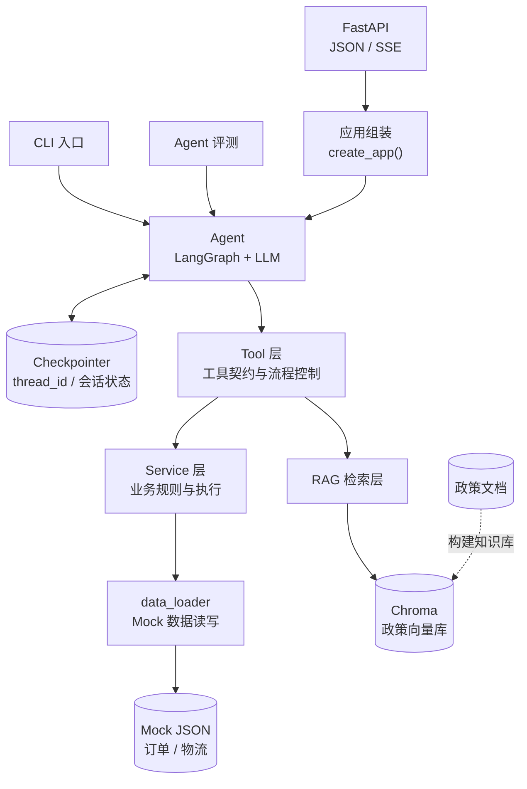
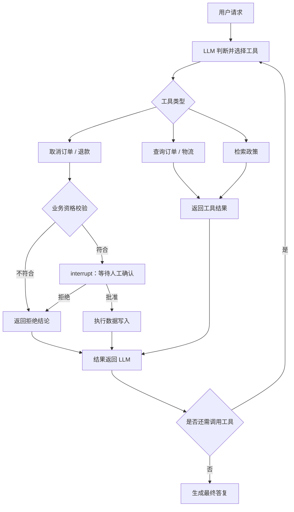

# customer-service-agent

基于 LangChain / LangGraph 的智能客服 Agent，支持订单查询、物流查询、知识库政策问答、取消订单和退款受理。Agent 根据用户需求决定是否调用工具；涉及取消或退款时，先由业务层校验办理资格，再进入人工确认流程，批准后才执行数据写入。

项目重点不只是实现 Tool Calling，还包括**业务规则分层、人工确认与写入保护、多轮会话管理、HTTP/SSE 接入，以及自动化测试和真实模型评测**。

## 核心功能

### Agent 与 Tool Calling

基于 LangGraph `create_agent` 构建 Agent，使用 LLM 决定工具调用及后续步骤。工具执行结果返回模型后，Agent 可以继续调用工具，直至生成最终答复。

| 工具               | 功能                             | 数据写入 |
| ------------------ | -------------------------------- | -------- |
| `query_order`      | 查询订单状态、金额、商品等信息   | 否       |
| `query_logistics`  | 查询发货状态、物流信息           | 否       |
| `search_knowledge` | 检索退款、配送、售后等政策       | 否       |
| `cancel_order`     | 校验取消资格，人工批准后取消订单 | 是       |
| `refund_order`     | 校验退款资格，人工批准后受理退款 | 是       |

主要设计原则：

- **业务规则与流程控制分离：** Service 层负责业务资格判断和执行；Tool 层负责工具契约、流程控制及结果反馈。
- **高风险操作先确认、后写入：** 不符合办理条件时直接返回业务结论，不进入人工确认流程。
- **避免编造业务结果：** 工具未找到相关数据或可靠政策依据时，Agent 应如实说明。
- **明确业务状态：** 取消订单不等于退款，退款受理不等于款项到账。

### RAG 知识库

基于 Chroma 和 BGE 系列模型构建政策知识库，使用向量检索召回候选片段，再通过 CrossEncoder 重排并筛选相关内容。

检索链路：

1. 加载 `data/knowledge/` 中的政策文档。
2. 使用 Embedding 模型向量化并存入 Chroma。
3. 根据用户问题召回候选片段并重排。
4. 将相关政策片段返回给 Agent，由 LLM 生成最终答复。

**RAG 负责检索政策依据，最终回答由 LLM 生成。** 当没有检索到足够相关的依据时，工具返回未检索到的提示，避免将模型常识当成业务政策。

### 短期记忆与 Checkpointer

使用 LangGraph Checkpointer 保存图状态，通过 `thread_id` 区分会话。相同线程的后续请求可以继续使用此前的消息和工具结果，从而支持多轮对话及订单指代。

当前使用 `InMemorySaver`，状态仅在当前进程内有效；服务重启后无法恢复此前的会话状态。

会话凭证与 thread_id 绑定，续轮请求必须携带 session_token；生产入口 create_app 无条件注入 SessionStore，无校验路径仅作为内部测试 seam 存在，由守卫测试钉住。

### HITL 人工确认

取消订单和退款受理使用 LangGraph `interrupt` 暂停流程，向人工确认端提供待确认信息。人工裁决后，通过 `Command(resume=...)` 恢复执行。

- 业务资格校验通过后才请求人工确认。
- 人工拒绝或业务条件不满足时，不执行数据写入。
- 人工批准后才执行相应的状态更新。

CLI 支持人工裁决。HTTP JSON/SSE 接口目前尚未实现完整的人工确认与恢复流程，详见[已知限制](#已知限制)。

### Skill 机制（SOP 注入与工具白名单）

将复杂业务（如退款）的专家 SOP 从写死的系统提示外置为可插拔配置包 `skills/<name>/SKILL.md`（YAML frontmatter + 正文），由 `app/skills/middleware.py` 的 `SkillMiddleware`（langchain 1.4 `AgentMiddleware`）在运行时装配进模型请求：

- **数据层（loader）**：`load_skill` 解析并校验 `name / description / allowed_tools / priority / body / triggers`，失败抛 `SkillValidationError`；只依赖标准库、PyYAML 与同目录 `exceptions.py`，由源码级守卫测试钉住该依赖边界。
- **注入（wrap_model_call）**：按 state 中的 `active_skill` 查预加载表，将 SOP 正文追加到 system prompt，并将 tools 过滤、重排为 `allowed_tools` 白名单顺序；不写 messages 历史，不改全局 `TOOLS`。
- **路由（before_model）**：仅对最后一条 `HumanMessage` 按 `triggers` 规则匹配，命中写入 `active_skill`，未命中显式清为 `None`；AI/Tool 消息轮"不表态"，因此 skill 跨工具循环与 HITL 恢复保持。
- **治理语义（有意设计）**：SOP 正文禁止硬编码业务阈值（金额/时效/到账），一律"以政策检索结果和工具返回为准"；skill 变更需重启进程生效；单个 SKILL.md 校验失败跳过该文件、降级为无 skill，不阻断对话。

### FastAPI JSON API 与 SSE

通过 FastAPI 提供 `POST /api/chat`，支持普通 JSON 响应和 SSE 流式响应。

- JSON 响应返回 `answer` 和 `thread_id`。
- SSE 通过 `token`、`done`、`error` 事件传递流式内容与结束状态。
- 未提供 `thread_id` 时，服务端创建新的会话 ID，并同时签发 `session_token`（JSON 响应体回显，SSE 放在 `X-Session-Token` 响应头）；客户端保存这两个值才能续聊。
- HTTP 层通过注入 Agent 处理请求，避免在每次请求中重复构建模型和业务组件。

## 系统架构



CLI、HTTP 和评测入口复用同一套业务实现，但各入口的 Agent 初始化方式和进程生命周期不同，不应将它们视为共享同一个内存会话实例。

主要分层职责：

| 层        | 职责                                 |
| --------- | ------------------------------------ |
| Agent     | 根据用户输入和工具结果决定下一步行动 |
| Tool      | 暴露工具、组织调用流程、处理人工确认 |
| Service   | 集中执行业务资格判断和业务操作       |
| 数据层    | 通过 `data_loader` 读写 Mock JSON    |
| RAG       | 检索并筛选政策依据                   |
| API / CLI | 提供不同的交互入口                   |

完整分层与依赖约束见 [docs/架构图.md](docs/架构图.md)。

## 核心执行流程



Agent 负责决策和组织调用；工具及业务层负责实际查询、规则校验和操作执行。涉及高风险操作时，只有通过资格校验并获得人工批准，才会进入写入步骤。

更多时序、记忆、SSE、RAG 和评测流程见 [docs/流程图.md](docs/流程图.md)。

## 技术栈

| 技术                          | 用途                                    |
| ----------------------------- | --------------------------------------- |
| Python 3.12、uv               | 运行环境与依赖管理                      |
| LangChain / LangGraph         | Agent、Tool Calling、Checkpointer、HITL |
| FastAPI、Uvicorn、Pydantic v2 | HTTP API、请求与响应校验                |
| Chroma                        | 政策向量库                              |
| BGE Embedding / CrossEncoder  | 文本向量化与检索重排                    |
| pytest                        | 自动化测试与契约验证                    |
| LangSmith                     | 可选的调用链追踪                        |

**环境注意：** 当前依赖组合主要在 Intel macOS x86_64 环境中验证。安装前请检查 `pyproject.toml`、`uv.lock` 及 Python 版本约束；其他平台可能需要调整依赖或 RAG 模型配置。

## 快速开始

### 1. 安装依赖

```
uv sync
```

### 2. 配置环境变量

```
cp .env.example .env
```

在 `.env` 中配置大模型服务的 API Key、模型名称和 OpenAI 兼容端点。请勿将真实密钥提交到代码仓库。

### 3. 构建知识库

首次运行或政策文档变更后执行：

```
uv run python scripts/build_knowledge_base.py
```

首次构建需要下载 Embedding 和 Reranker 模型，因此需要相应的网络访问条件。

### 4. 运行测试

```
uv run pytest
```

无需手动关追踪：`tests/conftest.py` 会在测试收集阶段强制关闭 LangSmith 追踪——追踪开启时，上报序列化会排空假模型的响应迭代器，导致既有用例成片假红（35 个，根因见《项目复盘笔记》6.10）。

### 5. 启动 API

```
uv run python scripts/chat_api.py
```

接口文档：`http://127.0.0.1:8000/docs`

### 6. 发送请求

```
curl -X POST http://127.0.0.1:8000/api/chat \
  -H 'Content-Type: application/json' \
  -d '{"message":"订单 ORD-2026-0001 现在什么状态"}'
```

响应包含 `answer` 和 `thread_id`，新建会话时还会返回 `session_token`（SSE 形态放在响应头 `X-Session-Token`）。续聊必须同时携带这两个值：只带 `thread_id` 或缺少/伪造凭据的请求一律 403，详见[已知限制](#已知限制)。

### CLI 演示

```
uv run python scripts/hitl_cli.py
uv run python scripts/stream_cli.py
```

前者用于演示包含人工确认的对话流程，后者用于演示流式输出。具体能力以各入口的实际实现为准。

## 测试与评测

### pytest：业务规则与工程契约

项目当前测试规模为 **353 个 pytest 用例**（2026-10-22 实测 `353 passed`，295 个测试函数 / 16 个测试文件），覆盖业务规则、工具行为、数据写入、会话状态、HTTP 契约、Skill 装配与注入及架构约束等内容。其中会话归属切片 15 个用例，覆盖轮换不触发、未知 thread 不签发、越权请求不产生 Agent 调用三类断言；Skill 切片 28 个用例（loader 11 / middleware 14 / HITL 集成 3），钉住 SOP 注入、白名单收窄、trigger 路由与跨 HITL 恢复的存活与清除语义。

测试采用假模型、临时数据副本和依赖注入等方式，避免普通测试依赖真实大模型调用，并降低对项目真实 Mock 数据文件的影响。

其中包括 20 条读取源码的架构守卫，用于约束模块依赖方向和关键逻辑的位置（含一条 `ast` 守卫：`app/skills/*` 除 `app.skills.exceptions` 外不得 import 任何 app 模块）。

复跑注意：无需环境变量前缀。开启 LangSmith 追踪时，上报序列化会排空假模型的响应迭代器，导致 35 个既有用例成片假红（`RuntimeError: generator raised StopIteration`），与业务代码无关；`tests/conftest.py` 已在收集阶段强制关闭追踪兜底（2026-10-22 裸跑 `353 passed` 实测，根因分析见《项目复盘笔记》6.10）。

### Agent 评测：真实模型行为

`eval/runner.py` 使用真实模型运行评测案例，通过确定性断言检查工具调用、业务结论、数据变化及最终回答中的指定内容，并与基线比较。

常用命令：

```
uv run python -m eval.runner
uv run python -m eval.runner --case E01,E05
```

项目已有记录为 12 条 case、86 个确定性断言。**历史记录不代表当前代码版本已经全部通过：**

- 2026-09-25 的一次全量评测为 86/86。
- 2026-09-26 的一次全量评测为 85/86，其中 E10 因回答中的禁词匹配出现误报。
- 评测依赖真实模型和外部模型服务；部分知识库案例还依赖模型文件及网络可达性。
- 当前评测主要依赖确定性断言，没有 LLM-as-judge；每条案例只运行一次，覆盖范围仍有限。

上述评测数据为项目已有的历史记录，本次 README 修订（2026-10-22）未重跑评测；pytest 已于同日实测复跑（见上节）。请在需要展示最新结果时，以实际运行结果为准。

### RAG 消融评测：检索链路质量

`eval/rag_ablation.py` 用 `eval/rag_ablation_queries.json`（23 条 query，标注基于真实 chunk 内容逐条核对的 `document_id + chunk_index`）对比三组检索配置：纯向量 Baseline、向量+重排无阈值 Treatment、带阈值过滤的线上链路 Online-like。判定为 chunk 级精确匹配，指标是 Hit Rate@K 与 MRR；参数全部读取 `app.config` 与 `rag_service`，不调 LLM、不改 `app/rag/` 任何代码。

```
uv run python eval/rag_ablation.py    # 网络不可达 huggingface.co 时加 HF_HUB_OFFLINE=1，走本地模型缓存
```

2026-10-19 运行结果（RETRIEVAL_K=10、CONTEXT_TOP_K=3，报告见 `eval/rag_ablation_result.md`）：

| 配置 | Hit Rate@3 | MRR |
| ---- | ---------- | --- |
| Baseline（纯向量） | 91.3% | 0.870 |
| Treatment（+重排，无阈值） | 87.0% | 0.826 |
| Online-like（线上链路） | 87.0% | 0.826 |

两点结论（n=23 小样本，仅作方向参考）：在 20 个 chunk 的小语料上，重排相对纯向量没有净收益；未命中全部集中在口语化 query，瓶颈在召回层而不是重排层。生产链路未因此变更。

## 已知限制

- **Mock JSON 数据层：** 不是生产数据库，文件整读整写且缺少并发保护，并发修改可能发生数据覆盖。
- **会话状态不持久化：** `InMemorySaver` 只在当前进程内有效，服务重启后无法恢复历史对话或待确认状态。
- **HTTP 人工确认流程不完整：** HTTP 同步路径对待确认操作返回 501，SSE 路径通过 `error` 事件报告问题；完整的 HTTP 确认与恢复机制尚未实现。
- **会话安全与归属校验：** 已实现会话级归属校验：服务端在新建会话时签发 session token 并绑定 thread_id，仅存 sha256 哈希、比对用 hmac.compare_digest；未知或伪造 thread_id 一律 403，绝不自动签发；错误凭证请求不会触发 token 轮换。用户级认证、速率限制、凭证过期与持久化会话存储在范围外。HTTP 路径不办理 HITL 为有意设计，resume 仅在 CLI/eval 提供。
- **退款业务不完整：** 当前主要建模 7 天无理由退款受理，不包含完整的退款结算回调、部分退款等流程；受理成功不代表实际到账。
- **评测覆盖有限：** 评测案例数量有限，确定性断言无法完整判断回答质量，也不能证明模型在所有输入下都可靠。
- **Skill 机制范围有限：** 目前仅落地退款一个 skill；路由是 triggers 子串规则匹配，无语义/LLM 路由（skill_router）、无多 skill 编排；预加载以重启换运行期零磁盘 IO，不支持热更新；`eval/runner.py` 尚未新增"模型服从 skill 红线"的行为级 case，现阶段红线送达由 pytest 注入层断言保证，模型听不听由禁词评测层负责、该层暂未覆盖 skill 场景。

因此，当前项目适合本地开发、工程实践与技术展示，不应被描述为已经具备生产环境所需的完整安全性、持久化能力和业务闭环。

## 详细文档

| 文档                                                         | 内容                                               |
| ------------------------------------------------------------ | -------------------------------------------------- |
| [架构图](docs/架构图.md)                                     | 模块分层、依赖方向与架构守卫                       |
| [流程图](docs/流程图.md)                                     | Agent 执行、HITL、记忆、SSE、RAG 和评测流程        |
| [项目复盘笔记](项目复盘笔记.md)                              | 按开发切片记录实现过程、设计取舍与验证结果         |
| [Customer Service Agent 项目复盘](<Customer Service Agent 项目复盘.md>) | 项目技术复盘、关键设计原则、面试讲解与后续演进方向 |
