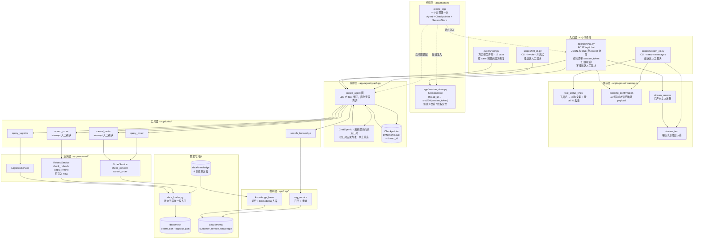
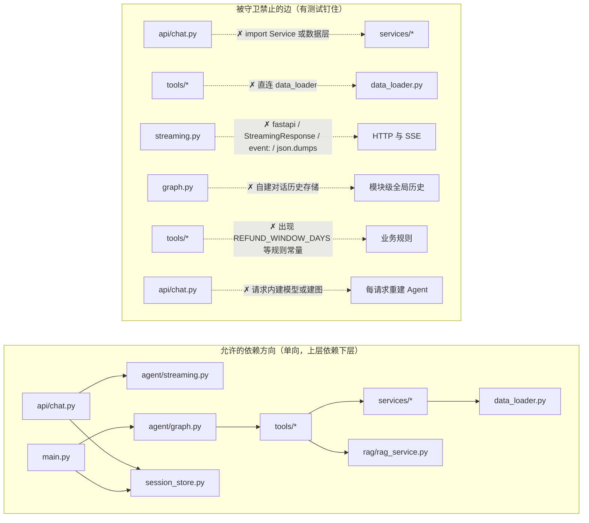
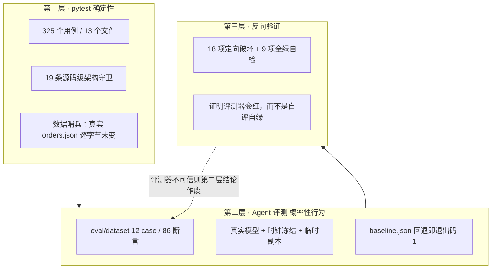

# 系统架构图

> 本页用 Mermaid 画**系统架构**（有哪些组件、依赖往哪个方向走、边界由谁守住）。
> 一次请求怎么跑、HITL 在哪里暂停、SSE 事件怎么排布见 [流程图](流程图.md)；
> 运行方式与能力清单见 [../README.md](../README.md)，过程决策与踩坑见 [../项目复盘笔记.md](../项目复盘笔记.md)。
>
> 图中每个节点都对应真实文件路径。Mermaid 在 GitHub 与 IDE 的 Markdown 预览里直接渲染。

---

## 1. 总览：四个入口，一个 Agent

核心形状是**「一份业务能力，多个消费端」**：CLI（非流式）、CLI（流式）、HTTP（JSON / SSE）、评测 runner
四条入口最终都落到同一个 `create_customer_service_agent()` 实例和同一份 checkpointer 上，
工具、规则、数据写回只有一套实现。

读图要点：

- **展示层在入口与 Agent 之间，不在 Service 之下**。它只做取数与查表，不做 IO、不产生业务结论，
  也不认识 HTTP／SSE（SSE 的分帧与编码只在 `app/api/chat.py`）。
- **`interrupt` 在 Tool 层，判定在 Service 层**。工具负责「该不该调用、要不要暂停、怎么措辞」，
  Service 负责「业务上能不能」，规则常量（如退款时效天数）不允许出现在工具里。
- **写入只有一条路**：Service → `data_loader` → `data/mock/*.json`。`interrupt` 之前只发生读操作，
  因为 LangGraph 恢复时 Tool 节点会从中断点前重放。
- **`CKPT` 是一份存储、两个用途**：HITL 的暂停与恢复 + 同一 `thread_id` 的多轮上下文。
- **会话归属校验收在路由层与 `session_store.py` 两处**：路由只在新建会话分支签发 `session_token`，
  续轮校验失败统一 403（不签发、不轮换、不透露 thread 是否存在）；存储只留 sha256、定时比较。
  Tool / Service / 数据层对这份凭证零感知——`create_chat_app` 的 `session_store=None` 只作内部测试 seam，
  由装配守卫钉住生产入口必注入。

---

## 2. 分层职责与对应文件

| 层 | 文件 | 负责 | 明确不负责 |
| --- | --- | --- | --- |
| 入口 | `scripts/hitl_cli.py`、`scripts/stream_cli.py`、`app/api/chat.py`、`eval/runner.py` | 与人／客户端的交互形态：输入输出、状态码与事件分帧、会话归属校验（签发与 403 语义） | 业务规则、数据读写、措辞之外的结论 |
| 组装 | `app/main.py::create_app` | 一个进程建一次 Agent、Checkpointer 与 SessionStore，再交给路由 | HTTP 契约、业务规则、模块级全局 app |
| 编排 | `app/agent/graph.py` | 系统提示口径、绑定 TOOLS、构建模型 | 自建对话历史存储（唯一载体是注入的 checkpointer） |
| 展示 | `app/agent/streaming.py` | 取可展示正文、工具名→状态文案、读待确认 payload、把流跑成文本增量 | IO、业务结论、HTTP／SSE 概念 |
| 工具 | `app/tools/*_tools.py` | 调用检查、是否 `interrupt`、面向用户的措辞 | 规则常量、直连 `data_loader` |
| 业务 | `app/services/*_service.py` | 判定（只读 `check_*`）与执行（写库）分离，执行前重新判定 | 直接读写文件、用户话术 |
| 检索 | `app/rag/knowledge_base.py`、`app/rag/rag_service.py` | 入库（切分 + Embedding）与召回重排（底线过滤） | 生成最终答案（Agent 是唯一回答者） |
| 会话存储 | `app/session_store.py` | thread_id → sha256(session_token) 的签发／校验／存在性判定，`threading.Lock` 线程安全，存储读写收在三个私有方法（可换 SQLite） | 产生 thread_id、HTTP 语义、业务规则 |
| 数据 | `app/data_loader.py`、`data/mock/*.json` | 状态字段的唯一写入口 | 被 Tool 层直接引用 |

---

## 3. 依赖方向与被守卫禁掉的边

架构约束不靠 code review 靠记忆，所以每条都用 `inspect` / `ast` 直接读源码断言，共 **19 条源码级守卫测试**，
分布在 9 个测试文件里。「该出现的没出现」和「不该出现的出现了」都会让它们变红。

| 禁掉的边 | 为什么禁 | 守卫测试所在 |
| --- | --- | --- |
| API → Service / data_loader | 端点不能自己判断「能不能取消」，否则同一规则在 HTTP 与 CLI 两处漂移 | `tests/test_chat_api_slice.py` |
| Tool → data_loader | 措辞层一旦能直接改数据，写库就可能跑到 `interrupt` 之前 | `tests/test_query_order_slice.py`、`tests/test_query_logistics_slice.py` |
| streaming.py → HTTP / SSE | 展示层若认识 SSE，CLI 与 HTTP 就会被同一份代码绑死 | `tests/test_http_streaming_slice.py` |
| graph.py → 自建历史存储 | 记忆的载体必须只有注入的 checkpointer 一份 | `tests/test_conversation_memory_slice.py` |
| Tool → 规则常量 | 「7 天」出现在两处就会各漂一次，且与政策文档冲突 | `tests/test_refund_slice.py`、`tests/test_cancel_order_slice.py` |
| 请求内建模型／建图 | 一个进程只组装一次，否则每请求重建 checkpointer，多轮与待确认全丢 | `tests/test_chat_api_slice.py` |

---

## 4. 质量与验证体系挂在架构的哪一格

**当前覆盖边界**（详见 [../README.md 的已知限制](../README.md#已知限制)）：
CLI 流式与 HTTP/SSE 都只有 pytest 覆盖，`eval/runner.py` 仍走 `invoke()`，
所以「同一句话经 HTTP 与经 CLI 是否给出同一个回答」没有机器判定；评测最后一次 86/86 全绿是 2026-09-25。
