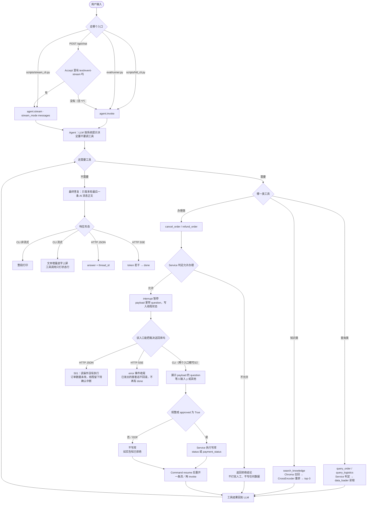
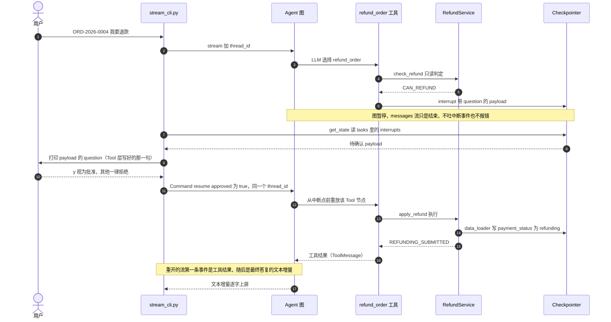
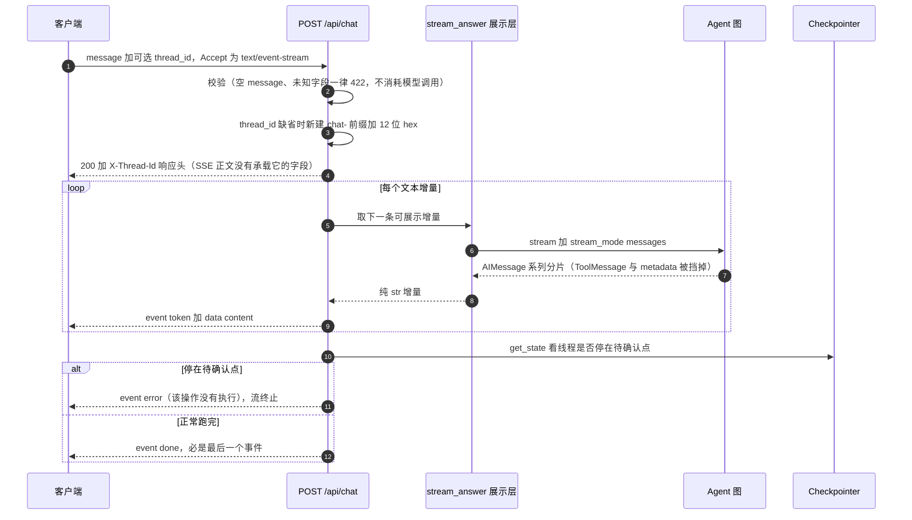
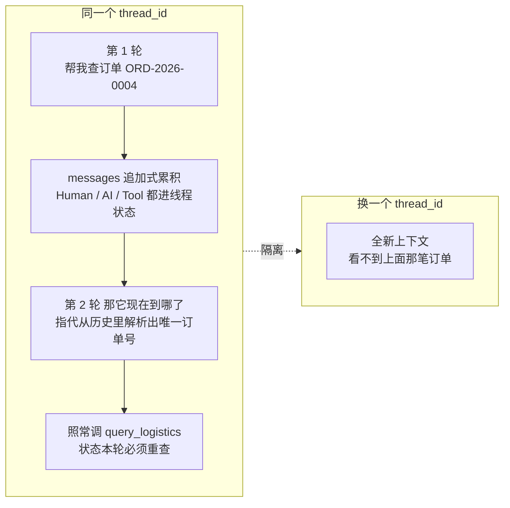
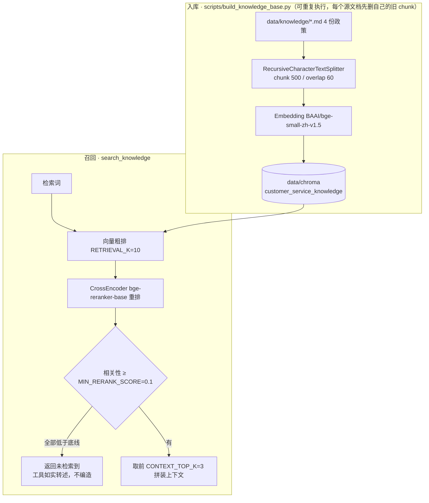
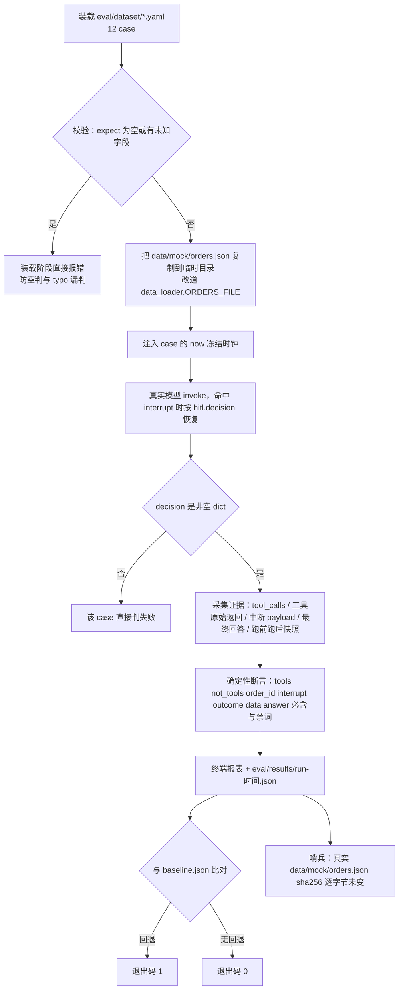

# 流程图

> 本页用 Mermaid 画**运行时流程**：一次请求怎么跑、高风险动作在哪里暂停、SSE 事件怎么排布、评测怎么隔离执行。
> 组件与依赖方向见 [系统架构图](架构图.md)；口径与实现细节见 [../README.md](../README.md)。

---

## 1. 一次请求的完整流程

四个入口汇到同一套 Agent 装配（各自进程内只组装一次）；唯一的分叉点在「办理类工具」上 —— 它要先由 Service 判定资格，
再决定是否 `interrupt`，而**能不能把人工裁决送回来取决于入口是哪一种**。

三条容易看错的分支：

- **HTTP 两个通道都不办理人工确认**。同步路径返回 501，流式路径发 `error` 事件；
  这一笔不写数据，但该线程会留下一个待确认中断和一条没有工具结果的 AI 消息 —— 收到拒绝应换 `hitl_cli.py` 或换新会话。
- **`Accept: */*` 不算流式**。它是 curl 与多数客户端的默认值，算进去会悄悄改变所有既有客户端的响应形态。
- **不允许办理的订单绝不进入确认环节**：`interrupt` 之前只有读操作，因为恢复时 Tool 节点会从中断点前重放。

---

## 2. HITL：暂停在哪里、裁决怎么送回去

以流式 CLI 受理退款为例（`invoke` 路径同理，只是 `__interrupt__` 直接从返回值里读）。

**裁决的形状是硬约束**：只有 `{"approved": True}` 算批准，`False`、`"yes"` 等一律按拒绝（fail-closed）；
而 `{}` 和 `None` **不是拒绝，是根本不会恢复执行** —— 空字典被当成零条记录的 resume-map 原地重复中断，
`None` 在库内部抛 `UnboundLocalError`。所以调用方必须自己把人工回应规整成 `{"approved": bool}` 再 `resume`。

---

## 3. HTTP：同一条端点上的 JSON 与 SSE 两种形态

- **收尾一定要读线程状态，不能用「本轮有没有文本增量」代替**：真实模型常态是先回一句「我来帮您取消」再调工具，
  那句客套话已经到了客户端，图却才刚停在确认位上。这条是 2026-09-29 真实模型 smoke 撞出来的，
  由 `test_preamble_tokens_do_not_hide_a_parked_confirmation` 钉住。
- **流一旦开始就只能回 200**：响应头此时已发出，Agent 侧异常只能靠 `error` 事件表达，异常原文只进服务端日志。
- 不带 `Accept: text/event-stream` 时走同步分支：`invoke` → 命中 `__interrupt__` 则 501，
  否则返回 `{"answer", "thread_id"}`；模型调用报错返回 500，不是一条空 `answer`。

---

## 4. 多轮记忆：一份 Checkpointer，两个用途

口径约束（写进系统提示并有测试守卫）：历史里出现过多笔订单时列候选请用户说明、不猜；
**沿用的只允许是订单号**，订单与物流状态本轮重新调用工具获取；上一轮人工批准不等于本轮已获批准。
载体缺失不报错：不注入 checkpointer 时每轮都是全新上下文，且 HITL 的暂停恢复一并失效。

---

## 5. RAG 链路：入库与召回是两条独立的路

**换 Embedding 模型必须重建整个知识库**（新旧向量不在同一空间）。RAG 只返回知识上下文，
最终答案仍由 Agent 这唯一的 LLM 生成 —— 链路里不嵌套第二个 LLM。

---

## 6. 评测怎么隔离执行

`eval/runner.py` 是唯一入口；`eval/min_runner.py` 与 `min_hitl_runner.py` 是手写的演示链路，不参与评测。

判法只有结构化断言，没有 LLM-as-judge；每条 case 只跑一次（n=1）。
代价已实测到：真实模型的措辞抖动足以让 blocking case 偶发红（见 README 里的 E10），报红时先单跑 3 次取多数再定性。
